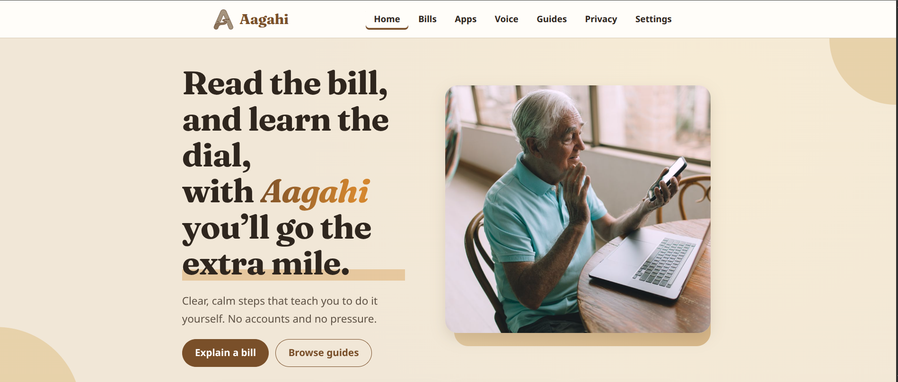
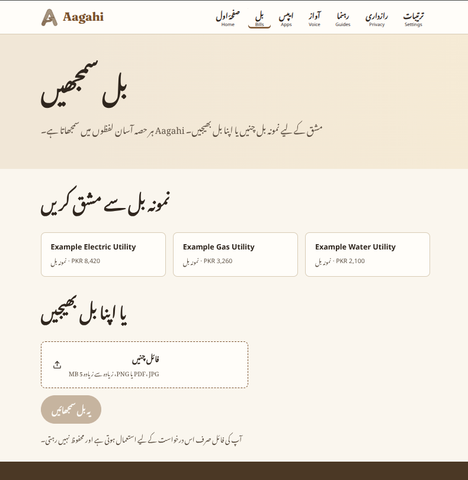
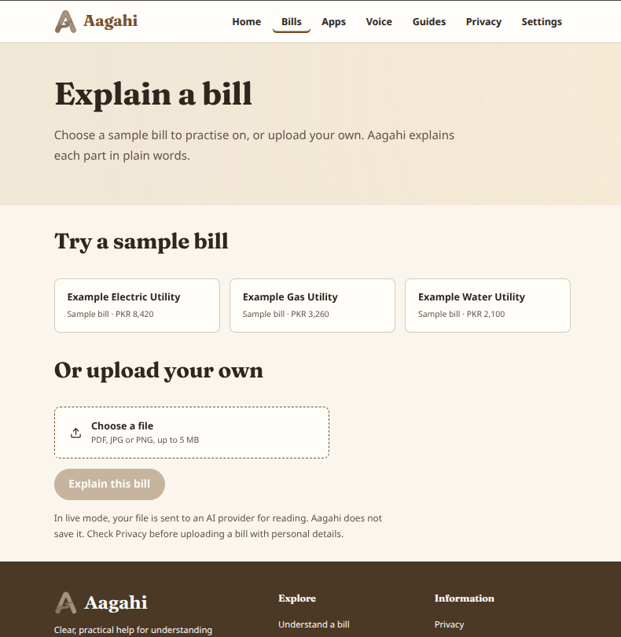
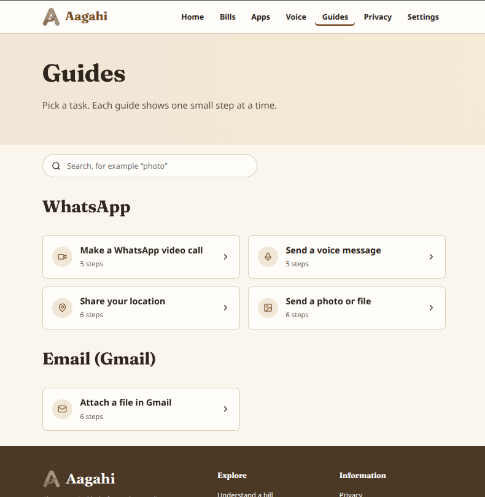
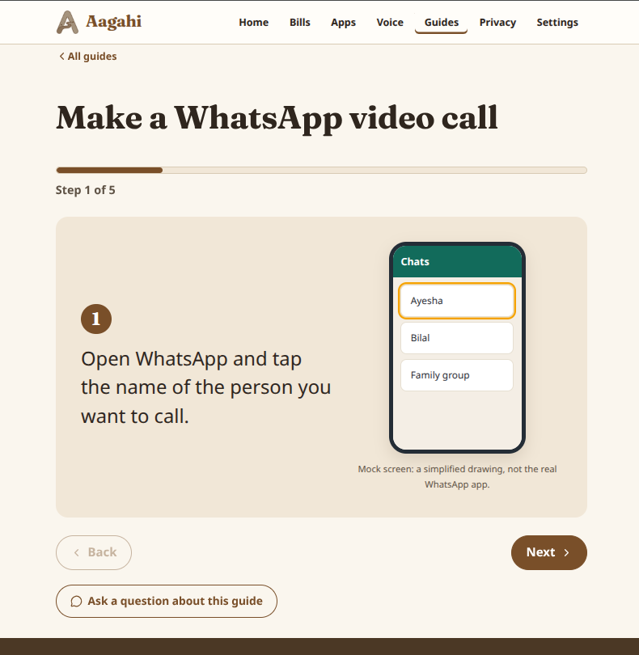
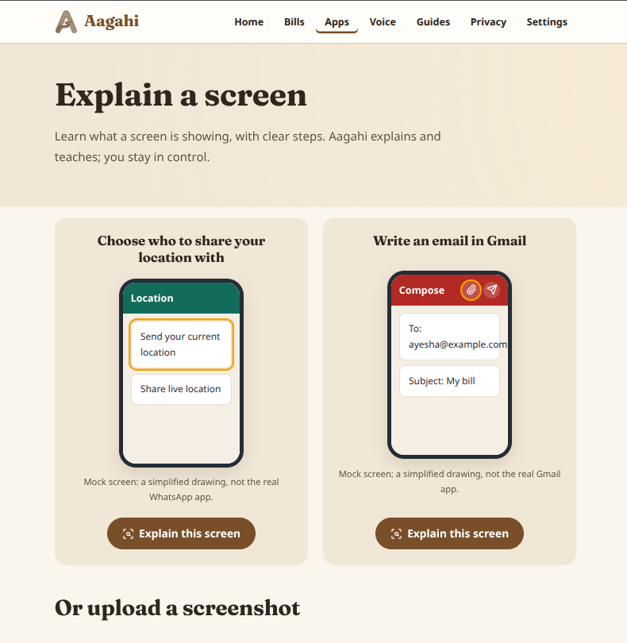
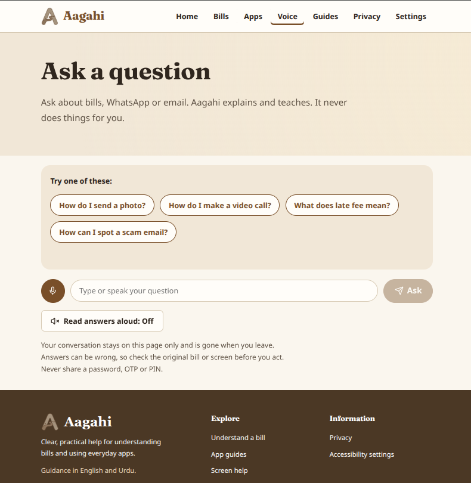
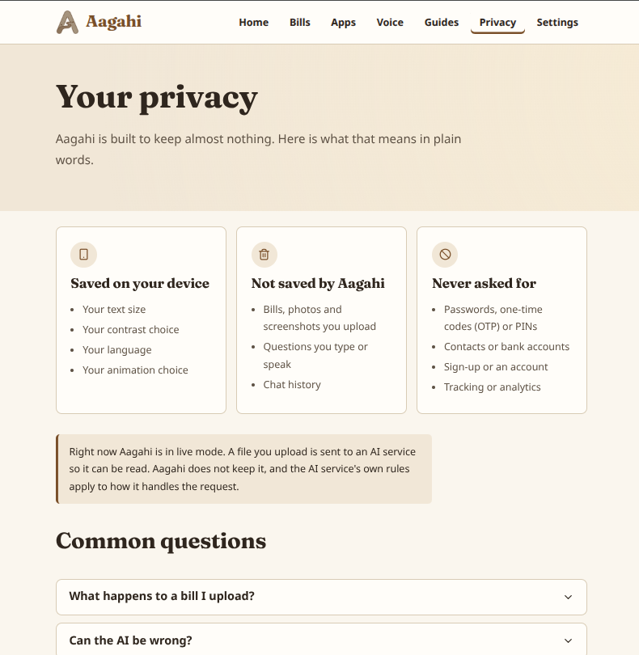
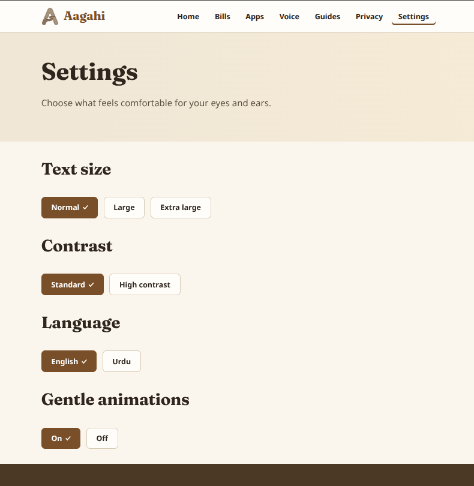

# Aagahi

Aagahi is a learning tool for older adults (ages 55–75). It helps people understand bills and learn WhatsApp and Gmail tasks through plain-language explanations and step-by-step guidance. Aagahi teaches the user to act; it never pays bills, sends messages, or taps through an app for them.

> Work on this project started on the hackathon build day.

## Project layout

- `Frotend/` — React and Vite web application. The directory name is intentionally spelled this way in the repository.
- `Backend/` — API service used by the frontend. See `Backend/README.md` for backend-specific setup.

## Frontend setup

### Requirements

- Node.js and npm
- The backend is optional for local development. Without it, static guides and built-in examples remain available.

### Install and run

```sh
cd Frotend
npm install
cp .env.example .env
npm run dev
```

Vite prints the local development URL in the terminal. To make a production build, run `npm run build`. To check frontend lint, run `npm run lint`.

### Frontend configuration

The frontend reads `VITE_API_BASE_URL` as the backend base URL. It defaults to `http://localhost:4000`; use no trailing slash. For example:

```env
VITE_API_BASE_URL=http://localhost:4000
```

Vite embeds `VITE_` variables in browser code. Never put passwords, API keys, or other secrets in a `VITE_` variable.

## Frontend stack

- React with Vite
- React Router for page navigation
- Lucide React icons
- Plain CSS in `Frotend/src/index.css`, using CSS variables
- Fontsource fonts: Noto Sans, Noto Nastaliq Urdu, and Fraunces
- JavaScript and JSX; no TypeScript or Tailwind

## Pages and screenshots

### Home

The Home page has quick tasks for bills, screenshots, WhatsApp, Gmail, and questions, plus feature cards and a privacy reminder.



### Urdu Language Support



### Bills

Choose a built-in sample bill or upload a PDF, JPG, or PNG file. The page presents a plain-language explanation and lets the user ask follow-up questions. The user checks the original bill before taking action.




### Guide Library

Browse and search the static WhatsApp and Gmail learning guides. Guide titles are available in English and Urdu.



### Guide Steps

Each guide presents one instruction at a time, with Back, Next, and Finish controls. Urdu mode displays Urdu instructions while retaining the English instruction as a smaller helper reference. The recreated phone mock screens remain illustrative and are not the real WhatsApp or Gmail apps.



### Screen Helper

Try a built-in mock screen or upload a PNG/JPEG screenshot for an explanation when the backend is in live mode. The page shows the analysis, confidence, and safety note, with suggested follow-up questions. Sample previews are simplified mock screens, not screenshots from the real apps.



### Ask

Ask about bills, WhatsApp, or email. The chat can use the backend when available and has built-in FAQ answers for common questions when offline. Voice input and spoken answers use browser speech recognition and speech synthesis when supported.



### Privacy

Read what Aagahi uses for a request, what is saved on the device, and what Aagahi never asks for. The page also explains live and offline behavior.



### Settings

Adjust text size, contrast, language (English or Urdu), and motion. Settings are saved in the browser's local storage. Urdu interface labels use Noto Nastaliq Urdu; English remains in Noto Sans.




## Feature status

| Feature | LIVE | CACHED | MOCKED / STATIC |
| --- | --- | --- | --- |
| Guides | Static guide content works without the API. | Same static guide content is available offline. | WhatsApp and Gmail screens are recreated illustrations, not the real apps. |
| Bills | The backend can read an uploaded bill when live mode is enabled. | Built-in sample bills use prepared explanations. | Sample bills are practice examples and are not connected to a utility provider. |
| Screen Helper | The backend can analyze an uploaded screenshot when live mode is enabled. | Built-in sample screens have prepared explanations; analysis of a user's own screenshot requires live mode. | Sample previews are simplified mock screens. |
| Chat | The backend can answer using its configured service. | Prepared answers may be served by the backend. | Built-in FAQ answers are used when the backend is unavailable. |
| Glossary | The backend glossary can be used when available. | A local JSON glossary is the fallback. | Glossary entries are static learning content. |
| Voice | Browser speech recognition converts speech to text; browser speech synthesis reads answers aloud. | Availability depends on browser support and permissions. | Aagahi does not run its own speech recognition or synthesis service. |

## Privacy

- Bill and screenshot uploads are used for the request and are not stored by the frontend. The backend processes uploads for the request only.
- Settings are stored in the browser's `localStorage`.
- Chat history stays in page memory and is cleared when the user leaves the page.
- The frontend does not create an account or store other user information.
- Some browsers may use a browser-vendor online service for speech recognition. Aagahi does not control that service.

## Known limitations

- AI explanations can be wrong. Users should check the original bill or screen before acting.
- Upload analysis needs a connected backend in live mode. Cached mode is for built-in sample content.
- Recreated mock screens are for practice and may differ from current WhatsApp or Gmail versions.
- Voice input depends on browser support, microphone permissions, and browser-vendor services.
- Urdu translations should be reviewed by a fluent Urdu speaker before submission.

## Third-party credits

- **Fonts:** Noto Sans, Noto Nastaliq Urdu, and Fraunces via Fontsource.
- **Icons:** Lucide React.
- **Photographs:** Add photographer names and licences before submission:
  - `Frotend/public/images/hero.jpg` — photographer: _to be added_; licence: _to be added_.
  - `Frotend/public/images/card-bills.jpg` — photographer: _to be added_; licence: _to be added_.
  - `Frotend/public/images/card-whatsapp.jpg` — photographer: _to be added_; licence: _to be added_.
  - `Frotend/public/images/card-gmail.jpg` — photographer: _to be added_; licence: _to be added_.

## AI tools used

- _To be completed by the project team with an honest list of tools used._
